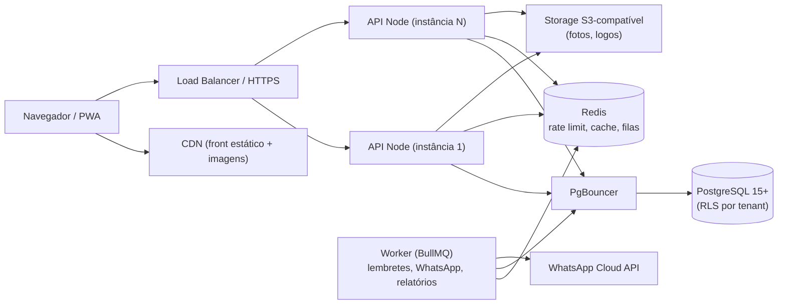
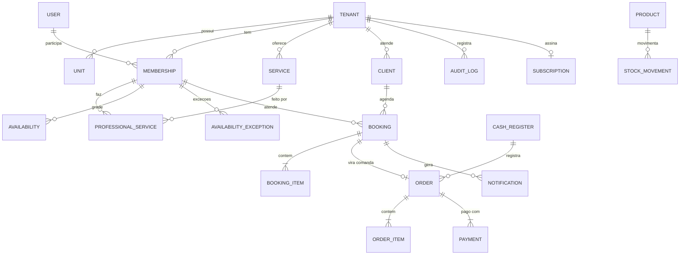

# 💈 Plataforma para Barbearias — Escopo e Requisitos v2.0

> **Versão:** 2.0 · **Data:** 11/11/2026 · **Base:** revisão do documento v1.0 (Barbearia Vikings)
>
> **Mudança principal:** o sistema deixa de ser o site de **uma** barbearia e vira uma **plataforma SaaS multi-barbearia** (multi-tenant). A Barbearia Vikings passa a ser o **primeiro cliente (piloto)**.
>
> **Legenda:** ✅ Implementado · 🟡 Parcial · ⏳ Pendente · 🆕 Novo nesta versão · ⚠️ Correção de algo que estava errado/arriscado na v1

---

## 0. Resumo da Revisão

### 0.1 O que estava bom na v1 (manter)
- Monorepo com módulos por domínio e tipos compartilhados.
- Validação com Zod, Helmet, bcrypt, JWT com segredos separados, rate limit no login.
- Máquina de estados do agendamento e exclusões lógicas.
- Estoque que só muda por movimentação (trilha de auditoria natural).
- Fila de notificações desacoplada do envio.

### 0.2 Problemas encontrados (resumo)

| # | Problema | Impacto | Onde foi tratado |
|---|----------|---------|------------------|
| P1 | O modelo atende **uma só barbearia** (sem `tenant`), mas o objetivo é atender várias | Bloqueia o produto | §3, §8 |
| P2 | Checagem de conflito "dentro de transação" **não impede double booking** no isolamento padrão do PostgreSQL (READ COMMITTED): duas requisições simultâneas leem "livre" e as duas gravam | Dois clientes no mesmo horário | RN03, RNF06 |
| P3 | Slots fixos de 35 min ignoram a duração do serviço (60 min aparece livre e falha com 409) | Frustração no agendamento | RF16, RN01 |
| P4 | Regras de negócio **fixas no código** (35 min, domingo fechado, 09–18h, 2 h para cancelar, 14 vs 30 dias) | Não serve para outras barbearias | §6, configurações por tenant |
| P5 | Inconsistência: a UI mostra 14 dias e esconde domingo "na mão"; a API permite 30 dias e calcula pela grade | Comportamento divergente | RF15 |
| P6 | "Nome e e-mail são atualizados a cada agendamento pelo telefone": **qualquer pessoa que souber um telefone sobrescreve os dados de outro cliente** | Segurança / LGPD | RN07 |
| P7 | Possível **IDOR**: `PUT /availability/:barberId`, `PUT /barbers/:id`, `GET /bookings/:id` exigem só "autenticado" — um barbeiro pode alterar a agenda de outro | Segurança | RF26, §9 |
| P8 | Webhook público do WhatsApp sem verificação de assinatura | Segurança | RF62 |
| P9 | Rate limit e sessão em memória: não funcionam com mais de uma instância da API | Escalabilidade | RNF |
| P10 | Agendamento não guarda **preço e duração no momento da reserva**; mudar o preço do serviço altera o histórico | Relatórios errados | §8 |
| P11 | Fuso horário dependente de `TZ` do container | Horários errados em outro fuso / horário de verão | RN16 |
| P12 | Status `PENDING` existe, mas todo agendamento nasce `CONFIRMED` | Regra morta / confusa | RN04 |
| P13 | Agendamento público sem proteção contra abuso (bots lotando a agenda) | Disponibilidade | RF21b |
| P14 | Não há LGPD (consentimento, exclusão de dados, retenção) | Legal | RNF |
| P15 | "Gestão do negócio" sem caixa, comanda, comissão nem relatórios | Não entrega o objetivo de gestão | §5.9 |
| P16 | Sem testes, CI, backup ou metas mensuráveis (SLA, tempo de resposta) | Confiabilidade | §7 |

---

## 1. Visão Geral

Plataforma web (SaaS) para barbearias que reúne:

1. **Página pública de cada barbearia** (`app.dominio.com/{slug}` ou subdomínio próprio) com agendamento online 24h, sem cadastro.
2. **Painel de gestão** da barbearia: agenda, equipe, serviços, clientes, estoque, caixa, comissões e relatórios.
3. **Painel da plataforma** (nós): cadastro de barbearias, planos, cobrança e suporte.

### Objetivos do negócio
- Reduzir agendamento por telefone/WhatsApp com autoatendimento online.
- **Zero double booking**, inclusive com muitos acessos simultâneos.
- Base de clientes com histórico, recorrência e fidelidade.
- Controle de estoque, caixa e comissão dos barbeiros.
- Confirmações e lembretes automáticos por WhatsApp (reduzir no-show).
- Permitir que **qualquer barbearia** se cadastre e configure as próprias regras sem mudar código.

---

## 2. Escopo

### 2.1 Dentro do escopo
| # | Item | |
|---|------|---|
| E1 | Multi-tenant: várias barbearias, cada uma com uma ou mais **unidades** | 🆕 |
| E2 | Página pública por barbearia (dados, serviços, equipe, vitrine, FAQ, contato) | |
| E3 | Agendamento online em 4 etapas, sem cadastro, com cancelamento/remarcação por link | |
| E4 | Motor de disponibilidade baseado na **duração do serviço** | ⚠️ |
| E5 | Autenticação com papéis por barbearia (Dono, Gerente, Recepção, Barbeiro) | ⚠️ |
| E6 | Gestão de serviços, equipe, clientes, agenda, produtos e estoque | |
| E7 | **Comanda / caixa** (registrar o que foi feito e pago no balcão) | 🆕 |
| E8 | **Comissão** de barbeiros e **relatórios** básicos | 🆕 |
| E9 | Notificações por WhatsApp (confirmação, lembrete, cancelamento) com fila e retentativas | |
| E10 | Planos e cobrança das barbearias (assinatura da plataforma) | 🆕 |
| E11 | Conformidade com a LGPD | 🆕 |

### 2.2 Fora do escopo (nesta versão)
- Pagamento online do cliente final (sinal/pré-pagamento) → avaliar na fase 4.
- E-commerce com carrinho (a loja continua vitrine; botão "Reservar pelo WhatsApp").
- App mobile nativo (o site é responsivo e pode virar **PWA**).
- Emissão de nota fiscal (integrar depois com um emissor).

---

## 3. Atores e Perfis

Um mesmo usuário pode participar de mais de uma barbearia com papéis diferentes (**vínculo usuário ↔ barbearia**).

| Ator | Escopo | Pode |
|------|--------|------|
| **Super Admin** 🆕 | Plataforma | Gerenciar barbearias, planos, suporte (acesso a dados de tenant só com registro em auditoria) |
| **Dono (OWNER)** 🆕 | Barbearia | Tudo da barbearia, inclusive financeiro, plano e equipe |
| **Gerente (MANAGER)** 🆕 | Unidade(s) | Agenda, equipe, serviços, estoque, caixa; sem plano/cobrança |
| **Recepção (RECEPTIONIST)** 🆕 | Unidade | Agenda de todos, encaixes, comanda, clientes; sem financeiro consolidado |
| **Barbeiro (BARBER)** | Ele mesmo | A própria agenda, a própria disponibilidade, as próprias comissões |
| **Cliente final** | Público | Agendar, cancelar/remarcar pelo link recebido |
| **Sistema externo** | — | WhatsApp (webhook assinado), gateway de cobrança (webhook assinado) |

> ⚠️ Na v1 o ADMIN era um papel global. Agora o papel é **por barbearia**, e toda checagem de permissão considera `tenant + papel + dono do recurso`.

---

## 4. Arquitetura

**Monólito modular, stateless, escalando na horizontal.** Microsserviços não são necessários nesta fase; o gargalo real será o banco e as integrações, não a API.

| Camada | Tecnologias | Observação |
|--------|-------------|------------|
| Frontend | React 19, Vite, TS, Tailwind, React Router, TanStack Query | Mantido. Build estático servido por CDN |
| API | Node 20+, Express, TS, Prisma, Zod | Mantido. **Sem estado em memória** |
| Banco | PostgreSQL 15+ gerenciado | `timestamptz` em UTC, RLS, backup com PITR |
| Cache / filas | **Redis + BullMQ** 🆕 | Rate limit distribuído, jobs agendados (lembretes), retentativas |
| Arquivos | **S3-compatível** 🆕 (R2, S3, MinIO) | Upload por URL pré-assinada; nunca no disco da API |
| Observabilidade | **pino** (log JSON), **Sentry**, métricas, uptime 🆕 | Morgan só em dev |
| Infra | Docker, CI/CD (GitHub Actions), ambientes dev / staging / prod 🆕 | |

### Estratégia multi-tenant
- **Banco único, schema único, coluna `tenant_id` em todas as tabelas de negócio.** É o modelo mais simples de operar e aguenta milhares de barbearias.
- **Row-Level Security (RLS)** no PostgreSQL como segunda barreira: a API faz `SET app.tenant_id` por requisição/transação e as policies filtram. Assim, um `where` esquecido no código não vaza dados de outra barbearia.
- Índices e `UNIQUE` sempre começando por `tenant_id` (ex.: `UNIQUE(tenant_id, phone)` em clientes).
- Identificação do tenant: pelo **slug/subdomínio** nas rotas públicas e pelo **token** nas rotas autenticadas (nunca por um campo enviado no body).

---

## 5. Requisitos Funcionais

> Mantidos os IDs da v1 quando o requisito continua igual. Novos requisitos usam sufixo ou numeração a partir de RF70.

### 5.1 Página Pública da Barbearia

| ID | Requisito | Status |
|----|-----------|--------|
| RF01–RF08, RF10, RF11 | Hero, navbar, serviços, equipe, benefícios, vitrine, FAQ, contato, rodapé, skeleton/erro — **agora com textos, cores, logo e FAQ vindos da configuração do tenant** (não estáticos) | ⚠️ |
| RF06 | Vitrine: botão "Reservar pelo WhatsApp" com mensagem pronta (nome do produto) | ⏳ |
| RF09 | Mapa: link/embed do Google Maps a partir do endereço da unidade (embed simples, sem chave de API) | ⏳ |
| RF70 🆕 | SEO por barbearia: title/description, Open Graph, `LocalBusiness` (schema.org), sitemap | ⏳ |
| RF71 🆕 | Página pública renderizada de forma indexável (SSR/pré-render das páginas de barbearia) — SPA puro não ranqueia bem no Google | ⏳ |

### 5.2 Agendamento Online

| ID | Requisito | Status |
|----|-----------|--------|
| RF12–RF14 | Fluxo em 4 etapas; só barbeiros que fazem o serviço | ✅ |
| RF14b 🆕 | Opção **"Qualquer profissional"** (o sistema escolhe o primeiro livre / distribui a carga) | ⏳ |
| RF14c 🆕 | Escolher **mais de um serviço** no mesmo atendimento (ex.: corte + sobrancelha), somando as durações | ⏳ |
| RF15 ⚠️ | Datas exibidas = janela configurada pelo tenant (`max_advance_days`); dias fechados vêm **da grade de disponibilidade**, não de regra fixa na UI | 🟡 |
| RF16 ⚠️ | Horários livres calculados com a **duração total dos serviços** escolhidos (`GET /slots?barberId&date&serviceIds`) | 🟡 |
| RF17 | Dados do cliente: nome, telefone (normalizado em **E.164**), e-mail e observações opcionais | 🟡 |
| RF17b 🆕 | Aceite da política de privacidade e opt-in para receber mensagens no WhatsApp (LGPD) | ⏳ |
| RF18 ⚠️ | Cliente encontrado ou criado pelo telefone **dentro do tenant**; não sobrescreve dados existentes (ver RN07) | 🟡 |
| RF19–RF20 | Tela de sucesso e mensagens de erro de negócio | ✅ |
| RF21b 🆕 | Antiabuso: CAPTCHA invisível (ex.: Cloudflare Turnstile), limite de agendamentos ativos por telefone, rate limit por IP e por telefone | ⏳ |
| RF21c 🆕 | **Idempotência**: o front envia `Idempotency-Key`; clique duplo ou reenvio não cria dois agendamentos | ⏳ |
| RF22 | Cancelar/remarcar pelo link enviado (token assinado, de uso restrito àquele agendamento, expira após o horário) | ⏳ |
| RF22b 🆕 | Opcional por tenant: confirmar o telefone por **código no WhatsApp (OTP)** antes de concluir | ⏳ |
| RF22c 🆕 | **Lista de espera**: se não houver horário, o cliente entra na fila e é avisado se alguém cancelar | ⏳ |

### 5.3 Autenticação e Controle de Acesso

| ID | Requisito | Status |
|----|-----------|--------|
| RF23 ⚠️ | Login real na API. **Refresh token em cookie `httpOnly` + `Secure` + `SameSite`**; access token só em memória (não em `localStorage`, que fica exposto a XSS) | 🟡 |
| RF24 ⚠️ | Refresh com **rotação**: cada uso gera um novo refresh e invalida o anterior; reuso de token antigo revoga a sessão inteira. Tokens guardados com hash no banco | 🟡 |
| RF25 | `/auth/me` retorna usuário + barbearias/papéis | ✅ |
| RF26 ⚠️ | Autorização = **papel no tenant + posse do recurso**. Barbeiro só altera a própria disponibilidade/perfil; testes automatizados para cada rota | 🟡 |
| RF27 | Barbeiro só vê os próprios agendamentos (e os clientes que atendeu) | ✅ |
| RF28 | Guarda de rotas `/admin/*` no front | ⏳ |
| RF29 ⚠️ | Logout revoga o refresh token no servidor | 🟡 |
| RF72 🆕 | Recuperar senha por e-mail (link de uso único, expira em 30 min) | ⏳ |
| RF73 🆕 | Convite de membro da equipe por e-mail/WhatsApp (o convidado define a própria senha) | ⏳ |
| RF74 🆕 | 2FA (TOTP) opcional; obrigatório para Dono e Super Admin | ⏳ |
| RF75 🆕 | Bloqueio temporário após tentativas de login falhas (por conta, além do limite por IP) | ⏳ |
| RF76 🆕 | **Log de auditoria**: quem fez o quê e quando (login, mudança de preço, cancelamento, ajuste de estoque, estorno, acesso de suporte) | ⏳ |

### 5.4 Painel da Barbearia

| ID | Requisito | Status |
|----|-----------|--------|
| RF30 ⚠️ | Dashboard com **números reais**: agendamentos de hoje, ocupação da agenda, faturamento do dia, no-show do mês, estoque baixo | 🟡 |
| RF31–RF33 | Agenda em **visão por dia/semana e por barbeiro (colunas)**, filtros, mudança de status | 🟡 |
| RF33b 🆕 | Criar agendamento pelo painel (telefone/balcão) e **encaixe** (walk-in) sem horário marcado | ⏳ |
| RF33c 🆕 | Arrastar para remarcar, com a mesma validação de conflito | ⏳ |
| RF33d 🆕 | Atualização da agenda **sem recarregar a página** (começar com polling de 30 s via React Query; WebSocket/SSE só se necessário) | ⏳ |
| RF34–RF35 | Serviços: CRUD, ordem, categoria, preço, duração, **intervalo após o serviço (buffer)** | 🟡 |
| RF35b 🆕 | Preço/duração **por barbeiro** (barbeiro sênior cobra mais) | ⏳ |
| RF36–RF37 | Produtos e estoque com movimentações e histórico | 🟡 |
| RF38 | Equipe: cadastrar, convidar, desativar, associar serviços, definir % de comissão | 🟡 |
| RF39 | Disponibilidade: grade semanal, intervalos (almoço), exceções, feriados da unidade | 🟡 |
| RF40 | Clientes: busca, histórico, recorrência, observações (preferências de corte), tags | 🟡 |
| RF41 | Notificações: fila, status de entrega, reenvio manual | 🟡 |
| RF77 🆕 | **Configurações da barbearia**: dados, logo, cores, horários por unidade, duração do slot, antecedência mínima/máxima, prazo de cancelamento, se o agendamento nasce PENDING ou CONFIRMED, textos das mensagens | ⏳ |

### 5.5 Motor de Disponibilidade

| ID | Requisito | Status |
|----|-----------|--------|
| RF42–RF44 | Grade semanal, substituição em transação, exceções | ✅ |
| RF45 ⚠️ | Gerar horários de início a cada `slot_step` (configurável: 10, 15, 30 min…) e só oferecer os inícios em que **a duração total + buffer cabe** inteira na grade, sem conflito nem bloqueio | 🟡 |
| RF45b 🆕 | Respeitar antecedência mínima (ex.: não agendar com menos de 1 h) | ⏳ |
| RF45c 🆕 | Cache curto (Redis, 30–60 s) dos slots por barbeiro/dia, invalidado ao criar/cancelar agendamento | ⏳ |

### 5.6 Agendamentos

| ID | Requisito | Status |
|----|-----------|--------|
| RF46 ⚠️ | Garantia de não sobreposição **no banco** (constraint de exclusão, ver RN03), não só na aplicação | 🟡 |
| RF47–RF52 | Validações, listagem, agenda do dia, estados, estatística do cliente, notificações | ✅ |
| RF53 | Lembrete automático (ex.: 24 h e 2 h antes, configurável) via job agendado | ⏳ |
| RF78 🆕 | Guardar no agendamento o **preço e a duração vigentes** no momento da reserva | ⏳ |
| RF79 🆕 | Origem do agendamento (`ONLINE`, `PAINEL`, `WALK_IN`, `WHATSAPP`) para relatórios | ⏳ |
| RF80 🆕 | Política de no-show: após N faltas, exigir confirmação/OTP ou bloquear agendamento online daquele telefone (configurável) | ⏳ |

### 5.7 Produtos e Estoque
RF54–RF59 mantidos ✅. Acréscimos:

| ID | Requisito | Status |
|----|-----------|--------|
| RF81 🆕 | Venda de produto na comanda gera movimentação `OUT` automaticamente | ⏳ |
| RF82 🆕 | Custo do produto (para margem) e produtos de **consumo interno** (lâminas, toalhas) separados dos de venda | ⏳ |
| RF83 🆕 | Alerta de estoque baixo no dashboard e por notificação ao gerente | ⏳ |

### 5.8 Notificações

| ID | Requisito | Status |
|----|-----------|--------|
| RF60 | Fila com canal, tipo e status | ✅ |
| RF61 ⚠️ | Processamento por **worker** (BullMQ) com retentativa exponencial e limite de tentativas; a notificação é gravada **na mesma transação** do agendamento (padrão *outbox*) | 🟡 |
| RF62 ⚠️ | Webhook do WhatsApp com **verificação da assinatura** (`X-Hub-Signature-256`) e idempotência por ID da mensagem | 🟡 |
| RF63 | Envio pela WhatsApp Cloud API com **templates aprovados** pela Meta | ⏳ |
| RF64 | Processamento automático (worker contínuo + jobs agendados) | ⏳ |
| RF84 🆕 | Cliente responde "1 confirmo / 2 cancelo" e o status do agendamento é atualizado | ⏳ |
| RF85 🆕 | Respeitar opt-out ("SAIR") e o opt-in registrado | ⏳ |

### 5.9 Gestão Financeira 🆕

| ID | Requisito | Status |
|----|-----------|--------|
| RF86 | **Comanda**: ao concluir o atendimento, registrar serviços realizados, produtos vendidos, desconto, gorjeta e forma de pagamento (Pix, cartão crédito/débito, dinheiro, misto) | ⏳ |
| RF87 | **Caixa**: abertura, sangria/suprimento, fechamento com conferência por forma de pagamento | ⏳ |
| RF88 | **Comissão**: % por barbeiro e/ou por serviço/produto; relatório do período e marcação de "pago" | ⏳ |
| RF89 | Relatórios: faturamento por período/barbeiro/unidade, ticket médio, serviços mais vendidos, ocupação da agenda, no-show, clientes novos x recorrentes, clientes inativos há X dias | ⏳ |
| RF90 | Exportar relatórios em CSV | ⏳ |

### 5.10 Fidelização 🆕 (fase posterior)

| ID | Requisito | Status |
|----|-----------|--------|
| RF91 | Programa de pontos/carimbos configurável (ex.: 10º corte grátis) | ⏳ |
| RF92 | **Clube de assinatura** (ex.: cortes ilimitados por R$ X/mês) com controle de uso — modelo muito comum em barbearias no Brasil | ⏳ |
| RF93 | Campanha para clientes inativos (mensagem "sentimos sua falta") | ⏳ |

### 5.11 Plataforma (SaaS) 🆕

| ID | Requisito | Status |
|----|-----------|--------|
| RF94 | Cadastro self-service da barbearia com assistente de configuração inicial (dados, horários, serviços, equipe) | ⏳ |
| RF95 | Planos com limites (nº de profissionais, unidades, mensagens WhatsApp) e período de teste | ⏳ |
| RF96 | Cobrança recorrente via gateway nacional (Asaas, Pagar.me, Stripe) com webhook assinado; bloqueio suave por inadimplência (painel só leitura, agendamento público continua por X dias) | ⏳ |
| RF97 | Painel do Super Admin: barbearias, plano, status, uso, "entrar como" com auditoria | ⏳ |

---

## 6. Regras de Negócio

> ⚠️ Regras que eram constantes no código passam a ser **configurações do tenant com valor padrão**. A coluna "Padrão" mostra o valor inicial.

| ID | Regra | Padrão |
|----|-------|--------|
| RN01 ⚠️ | Intervalo entre inícios de horário (`slot_step`) é configurável e **independe** da duração do serviço | 15 min |
| RN02 ⚠️ | Agendamento só no futuro, respeitando antecedência mínima e máxima | mín. 1 h · máx. 30 dias |
| RN03 ⚠️ | Um barbeiro não pode ter agendamentos ativos (`PENDING`/`CONFIRMED`) sobrepostos. **Garantido por constraint no banco**: `EXCLUDE USING gist (barber_id WITH =, tstzrange(start_at, end_at) WITH &&) WHERE (status IN ('PENDING','CONFIRMED'))` (extensão `btree_gist`). A API trata a violação como 409 | — |
| RN04 ⚠️ | Status inicial configurável: `CONFIRMED` (padrão) ou `PENDING` (barbearia confirma manualmente ou cliente confirma pelo WhatsApp) | CONFIRMED |
| RN05 | Transições: `PENDING → CONFIRMED / CANCELLED`; `CONFIRMED → COMPLETED / CANCELLED / NO_SHOW`; estados finais imutáveis. Remarcar = alterar horário de um agendamento ativo (com nova checagem de conflito) | — |
| RN06 ⚠️ | O **cliente** só cancela/remarca até X horas antes; a **barbearia** pode cancelar a qualquer momento (com motivo e notificação ao cliente) | 2 h |
| RN07 ⚠️ | Cliente é único por `(tenant, telefone E.164)`. Dados existentes **não** são sobrescritos por agendamento público; nome/e-mail diferentes ficam no agendamento e a equipe decide atualizar. (Com OTP ativo, o cliente verificado pode atualizar os próprios dados) | — |
| RN08 | Cliente recorrente a partir de N atendimentos concluídos | 3 |
| RN09 ⚠️ | Fim = início + soma das durações dos serviços (do barbeiro, se houver preço/duração própria) + buffer | — |
| RN10 | O barbeiro precisa estar associado ao serviço | — |
| RN11 ⚠️ | Horário de funcionamento é **por unidade** e vem da configuração; a grade do barbeiro precisa estar dentro dele | Seg–Sáb 09–18 |
| RN12 | Estoque só muda por movimentação; ajuste define valor absoluto | — |
| RN13 | Estoque mínimo por produto | 5 |
| RN14 | Exclusões de serviço, barbeiro e produto são lógicas | — |
| RN15 | Pagamento do cliente final no local | — |
| RN16 🆕 | Datas/horas gravadas em **UTC (`timestamptz`)**; exibição e cálculo de slots no fuso da unidade (ex.: `America/Sao_Paulo`). Nunca depender do `TZ` do servidor | — |
| RN17 🆕 | Valores monetários em **centavos (inteiro)** ou `numeric(10,2)` — nunca `float` | — |
| RN18 🆕 | Comanda fechada não é editada; correção = estorno + nova comanda (trilha de auditoria) | — |
| RN19 🆕 | Comissão calculada sobre o valor **efetivamente pago** (após desconto), conforme regra do barbeiro/serviço | — |
| RN20 🆕 | Limite de agendamentos ativos por telefone no agendamento online | 2 |

---

## 7. Requisitos Não Funcionais

> ⚠️ Na v1 os RNFs não tinham metas. Sem número não dá para testar nem para saber se "escala".

| ID | Categoria | Requisito | Meta |
|----|-----------|-----------|------|
| RNF01 | Segurança | Senhas com **bcrypt (custo ≥ 12) ou argon2id** | — |
| RNF02 | Segurança | JWT access curto (15 min) + refresh rotativo em cookie httpOnly; segredos fora do código (variáveis de ambiente / secret manager) | — |
| RNF03 ⚠️ | Segurança | Rate limit **distribuído (Redis)**: global, por IP, por usuário e por telefone no agendamento público; login 5 tentativas/15 min | — |
| RNF04 | Segurança | Helmet, CORS restrito, **CSP**, HTTPS obrigatório com HSTS | — |
| RNF05 | Validação | Zod em body, query e params; limite de tamanho do body; upload só por URL pré-assinada com tipo/tamanho validados | — |
| RNF06 ⚠️ | Integridade | Regras críticas garantidas **no banco** (constraints, `UNIQUE`, `EXCLUDE`, `CHECK stock >= 0`) além da aplicação | — |
| RNF07 | Observabilidade | Log estruturado com `request_id` e `tenant_id`; erros no Sentry; métricas (latência, erros, fila); `/health` (liveness) e `/ready` (banco + Redis) | — |
| RNF08 | Padronização | Respostas `{ success, data, message }`; erros com código estável (`SLOT_TAKEN`, `OUTSIDE_HOURS`…) para a UI traduzir | — |
| RNF09 | Desempenho | p95 < 300 ms nas rotas de leitura; cálculo de slots p95 < 200 ms | ✔ medir |
| RNF10 | Escalabilidade 🆕 | API **stateless** (sem sessão, cache ou arquivo local) → escala adicionando instâncias. Pool de conexões via PgBouncer. Paginação obrigatória em toda listagem | 1.000 barbearias · 200 req/s sem mudança de arquitetura |
| RNF11 | Disponibilidade 🆕 | Deploy sem downtime (rolling); migrations compatíveis com a versão anterior | 99,5% mensal |
| RNF12 | Backup 🆕 | Backup automático com PITR; teste de restauração trimestral | RPO ≤ 15 min · RTO ≤ 4 h |
| RNF13 | Usabilidade | Mobile-first, PWA instalável para a equipe, acessibilidade (contraste, foco, labels) WCAG 2.1 AA | — |
| RNF14 | Localização | pt-BR; fuso por unidade; moeda BRL | — |
| RNF15 ⚠️ | Qualidade | Testes **obrigatórios** para: motor de slots, conflito concorrente (dois agendamentos simultâneos → só um passa), permissões por rota/tenant, estoque, comissão. CI roda lint + typecheck + testes em todo PR | Cobertura ≥ 80% nos módulos críticos |
| RNF16 🆕 | Isolamento | Teste automatizado garantindo que um tenant **nunca** lê/escreve dados de outro (RLS + testes de API) | — |
| RNF17 🆕 | LGPD | Base legal e consentimento registrados; política de privacidade; exportar e **anonimizar** dados de um cliente a pedido; retenção definida; dados pessoais nunca em logs nem em URL | — |
| RNF18 🆕 | Manutenibilidade | Monólito modular; módulos não acessam tabelas de outros módulos diretamente; versionamento da API (`/api/v1`) | — |

---

## 8. Modelo de Dados (revisado)

| Entidade | Campos principais | Mudança |
|----------|-------------------|---------|
| **Tenant** | nome, slug (único), plano, status, configurações (JSON validado), logo/cores | 🆕 |
| **Unit** | tenant, nome, endereço, telefone, fuso, horário de funcionamento | 🆕 |
| **User** | nome, e-mail (único global), hash da senha, 2FA, ativo | ⚠️ sem `role` |
| **Membership** | user, tenant, unidade(s), papel, % comissão, avatar, bio, ativo | 🆕 substitui o "barbeiro = User" |
| **RefreshToken** | user, hash, família, expira em, revogado em | 🆕 |
| **Client** | tenant, nome, telefone E.164, e-mail, consentimentos, total de atendimentos, última visita, recorrente, observações, anonimizado em | ⚠️ `UNIQUE(tenant_id, phone)` |
| **Service** | tenant, nome, descrição, categoria, preço, duração, buffer, ativo, ordem | ⚠️ |
| **ProfessionalService** | membership, serviço, preço/duração próprios (opcionais) | ⚠️ |
| **Availability / Exception** | membership, unidade, dia/data, faixas, motivo | ⚠️ |
| **Booking** | tenant, unidade, cliente, profissional, início/fim (`timestamptz`), status, origem, observações, token de gestão (hash), idempotency key | ⚠️ |
| **BookingItem** | agendamento, serviço, **preço e duração no momento** | 🆕 |
| **Order (comanda)** | agendamento (opcional), cliente, profissional, subtotal, desconto, gorjeta, total, status | 🆕 |
| **OrderItem** | serviço ou produto, quantidade, preço unitário, comissão calculada | 🆕 |
| **Payment** | comanda, forma, valor | 🆕 |
| **CashRegister** | unidade, aberto por/em, fechado por/em, valores conferidos | 🆕 |
| **Product / StockMovement** | + tenant, custo, tipo (venda/consumo) | ⚠️ |
| **Notification** | + tentativas, próximo envio, erro, ID externo | ⚠️ |
| **AuditLog** | tenant, usuário, ação, entidade, antes/depois, IP, data | 🆕 |
| **Subscription** | tenant, plano, status, gateway ID, vencimento | 🆕 |

**Índices essenciais:** todos começando por `tenant_id`; `bookings(barber_id, start_at)`; `bookings(tenant_id, start_at)`; `clients(tenant_id, phone)` único; `notifications(status, next_attempt_at)`; GIST de exclusão em `bookings`.

---

## 9. API — Ajustes

- Prefixo versionado: `/api/v1`.
- Rotas públicas identificam a barbearia pelo slug: `/api/v1/public/{slug}/services`, `/barbers`, `/slots`, `/bookings`, `/bookings/{token}` (consultar/cancelar/remarcar).
- Rotas autenticadas obtêm o tenant do token; trocar de barbearia = novo access token com outro `tenant_id`.
- ⚠️ Revisar permissões que hoje são só "autenticado":

| Rota v1 | Problema | Regra nova |
|---------|----------|-----------|
| `PUT /availability/:barberId` | Barbeiro altera grade de outro | OWNER/MANAGER, ou o próprio barbeiro |
| `PUT /barbers/:id` | Barbeiro edita perfil de outro | OWNER/MANAGER, ou o próprio (sem poder mudar papel/comissão) |
| `GET /bookings/:id` | Barbeiro vê agendamento de outro | Recepção+ ou o barbeiro do agendamento |
| `GET /clients` | Barbeiro vê toda a base | Recepção+; barbeiro só clientes que atendeu |
| `POST /notifications/webhook` | Sem verificação | Validar assinatura HMAC; rejeitar sem ela |

---

## 10. Mapa de Telas

| Rota | Tela | Acesso |
|------|------|--------|
| `/{slug}` | Página pública da barbearia | Público |
| `/{slug}/agendar` | Agendamento | Público |
| `/{slug}/agendamento/{token}` | Ver / cancelar / remarcar | Quem tem o link |
| `/cadastro` | Cadastro de nova barbearia | Público |
| `/login`, `/recuperar-senha`, `/convite/{token}` | Acesso | Público |
| `/app` | Dashboard | Equipe |
| `/app/agenda` | Agenda dia/semana por profissional | Equipe |
| `/app/comandas`, `/app/caixa` | Comanda e caixa | Recepção+ |
| `/app/clientes` | Clientes | Recepção+ (barbeiro: os seus) |
| `/app/equipe`, `/app/servicos`, `/app/produtos` | Cadastros | Gerente+ |
| `/app/relatorios`, `/app/comissoes` | Gestão | Dono/Gerente (barbeiro: as próprias comissões) |
| `/app/configuracoes`, `/app/plano` | Configurações e assinatura | Dono |
| `/plataforma/*` | Painel Super Admin | Super Admin |

---

## 11. Roadmap Sugerido

A ordem prioriza **o que é caro de mudar depois** (multi-tenant, modelo de dados, segurança) antes das telas.

### Fase 0 — Fundação (antes de qualquer tela nova)
1. Adicionar `Tenant`, `Unit`, `Membership` e `tenant_id` em todas as tabelas; migrar a Vikings como tenant 1.
2. Constraint de exclusão contra double booking + teste de concorrência.
3. `timestamptz` em UTC, preço/duração no agendamento, dinheiro em centavos.
4. Slots pela duração do serviço (corrige P3).
5. Autenticação real no front (cookie httpOnly, rotação, guarda de rotas, logout de verdade).
6. Corrigir permissões por posse do recurso (P7) e a sobrescrita de dados do cliente (P6).
7. Redis (rate limit distribuído) + CI com lint/typecheck/testes + Sentry + backups.

### Fase 1 — MVP vendável (Vikings em produção)
Agenda completa (filtros, status, encaixe, criar pelo painel), CRUDs de serviços/equipe/produtos/disponibilidade, clientes, configurações da barbearia, dashboard real, cancelamento por link, antiabuso, LGPD básica.

### Fase 2 — Gestão
Comanda, caixa, comissões, relatórios, exportação CSV.

### Fase 3 — Automação
Worker + WhatsApp Cloud API (confirmação, lembrete, resposta 1/2, cancelamento), lista de espera, política de no-show.

### Fase 4 — Plataforma e crescimento
Cadastro self-service, planos e cobrança, painel Super Admin, multiunidade, fidelidade, clube de assinatura, PWA, sinal/pré-pagamento opcional.

---

## 12. Decisões em Aberto

| # | Pergunta | Recomendação |
|---|----------|--------------|
| D1 | URL da barbearia: caminho (`/vikings`) ou subdomínio (`vikings.dominio.com`)? | Caminho no início (zero configuração de DNS); subdomínio/domínio próprio como recurso de plano superior |
| D2 | Hospedagem | Começar em PaaS (Render, Railway, Fly) + Postgres gerenciado (Neon, Supabase, RDS) + Upstash Redis; migrar para AWS/GCP quando o custo justificar |
| D3 | Provedor WhatsApp | API oficial (Cloud API da Meta) — soluções não oficiais podem ter o número banido |
| D4 | Gateway de cobrança das barbearias | Asaas ou Pagar.me (boleto/Pix/cartão recorrente nacionais) |
| D5 | SSR para SEO da página pública | Pré-render das páginas `/{slug}` (ou mover só a parte pública para um framework com SSR) — avaliar quando o SEO virar prioridade |
